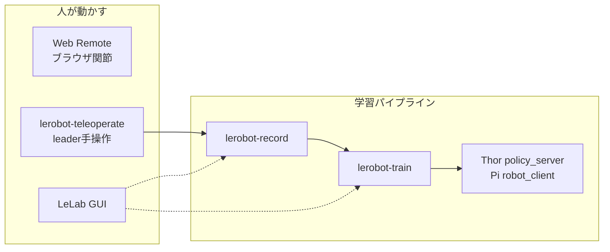

# 第0章 — ラボ地図: どこで何をするか

> 🎯 **章のゴール**
> ①Pi / GPU ホスト / Quest PC の役割を説明できる
> ②LeLab・Web Remote・lerobot CLI の使い分けが言える
> ③「第2駆動腕 OFF・leader は手テレオペ」の理由を一言で言える

**前提**: so101-lab を clone 済み。sim2rl の有無は任意（あると後が楽）。  
**本当のゼロ（部品箱・Pi 起動前）から来た人はまず [レッスン0: ゼロから Lab を立てる](00_setup_from_zero.md) へ。**

---

## 0.1 マシンと独占

| マシン | 主にやること | やらないこと |
|--------|--------------|--------------|
| **Raspberry Pi** | 実機接続、テレオペ、録画、推論クライアント | 本格 ACT/SmolVLA 学習、この Pi 4 での ACT 順伝播 |
| **4090 の WSL** | `lerobot-train`（ACT）。データセットの保管 | 実機シリアルは繋がっていない |
| **Jetson Thor** | ACT / MolmoAct2 の GPU 推論（`policy_server`） | 腕の USB は挿さない |
| **Quest / Isaac 用 PC** | XR テレオペ検証 | LeLab と同時に実機シリアルを奪わない |

詳細: [07_multi_host.md](../../07_multi_host.md) · 概要: [01_overview.md](../../01_overview.md)

**同時起動禁止の典型**: LeLab（`:8000`）↔ Web Remote（`:8765`）↔ Quest bridge / Thor robot client

---

## 0.2 ツールの地図

| やりたいこと | 使うもの |
|--------------|----------|
| 関節をブラウザでゆっくり確認 | Web Remote（`--no-leader` 可） |
| デモ用に leader→follower | `lerobot-teleoperate` / LeLab |
| データセット作成 | `lerobot-record` または LeLab Record |
| ACT / SmolVLA 学習 | GPU で `lerobot-train` |
| シムで報酬から reach を学習 | sim2rl の PPO。[手順](../01_concepts/03_rl_procedure.md) |
| 学習後に実機で試す | Thor の `policy_server` と Pi のクライアント。[17](../../17_act_record_train_infer.md) |

運用の入口: [README（リポ）](../../../README.md)

---

## 0.3 いまのハード方針（短腕・片腕）

物理 leader を **第2の駆動腕**にすると肘などがトルク不足（Overload）になりやすいです。

| 役割 | 方針 |
|------|------|
| 学習・推論の腕 | **follower のみ** |
| leader | **手で動かすテレオペ**（`so101_leader`） |
| Web Remote 第2ポート | `enabled: false`（[14](../../14_single_arm_il.md)） |

「短腕」は先端質量を減らすハード暫定策で、**学習カリキュラムの主経路は片腕 IL** です。  
トルク問題の背景: [13_drive_profiles.md](../../13_drive_profiles.md)

---

## 0.4 sim2rl との役割（30秒）

| リポ | 学習の主戦場 |
|------|----------------|
| **sim2rl** | シム内 RL、パリティ、System ID、論文系 IL（EVA-ACT 等） |
| **so101-lab** | 実機ポート、カメラ、LeRobot 録画・学習・ラボ運用 |

機体の「6関節とは何か」は先に  
[sim2rl 第1章 SO-101](../../../../sim2rl/docs/learn/01_so101/README.md) を読むと早いです。

---

## ✅ 理解度チェック

Q1. なぜ Pi で ACT を長時間学習しないのか？

計算が重く、この Pi 4 の torch では ACT の順伝播が Illegal instruction になる。デモ録画と推論クライアントは Pi、学習は 4090 の WSL、推論計算は Thor。

Q2. `my_leader` と `my_leader_drive` の違いは？

`my_leader` = 手テレオペ用（`so101_leader`）。`my_leader_drive` = Web Remote で旧 leader ポートを **駆動**する用（`so101_follower`）。片腕 IL では後者は使わない。

⏭️ 次: [01_concepts/](../01_concepts/README.md)
