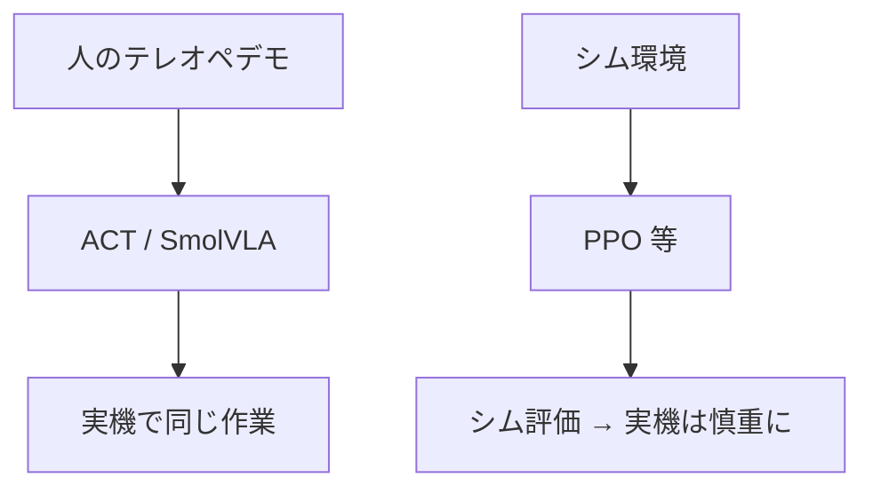

# 第1章レッスン1 — 模倣学習（IL）と強化学習（RL）

> 🎯 **ゴール**
> 「デモを真似する」と「試行錯誤で報酬を最大化する」の違いを自分の言葉で言える

---

## 1.1 二つの学び方

| | 模倣学習（IL） | 強化学習（RL） |
|--|----------------|----------------|
| 教師信号 | **人のデモ**（軌道） | **報酬**（成功したか等） |
| 典型データ | 録画した `(観測, 行動)` | 環境と相互作用した軌跡 |
| ラボでの主ツール | LeRobot ACT / SmolVLA | sim2rl の PPO 等 |
| 実機との相性 | デモが取れれば始めやすい | 実機だと失敗コストが高い |

このラボの **実機ルート（本カリキュラム）** は当面 **IL** です。  
**シムで報酬から学ぶルート**は [レッスン3の手順](03_rl_procedure.md) で一周し、詳しくは sim2rl の RL カリキュラムです。どちらも SO-101 を対象にします。

| ルート | 最初に読む論文 | 手順 |
|--------|----------------|------|
| 実機 IL | [ACT](https://arxiv.org/abs/2304.13705)（R-PAPER-ACT） | 第2章 |
| シム RL | [PPO](https://arxiv.org/abs/1707.06347)（R-PAPER-PPO） | [03_rl_procedure.md](03_rl_procedure.md) |

一覧: [papers.md](../papers.md)



---

## 1.2 「画像認識してから操作する」との違い

古典的パイプライン:

```text
画像 → 物体検出 → 計画 → 関節指令
```

ACT 系の IL:

```text
画像 + 関節角 → ニューラルネットワーク → 関節指令のチャンク
```

途中に「赤キューブの座標」などの**明示モジュールが無い**ことが多いです。  
ネットワークがデモから「こういう見え方のときはこう動いた」をまとめて覚えます。

---

## 1.3 なぜ最初に ACT か

1. **軽い**（〜数十分〜数時間で学習の感触が得られることが多い）
2. **言語が不要**（まず「真似できるか」に集中できる）
3. **失敗してもデータとカメラ設定の問題に切り分けやすい**

言語や声で切り替えたい欲求が出たら第3章（SmolVLA）へ進みます。

---

## ✅ 理解度チェック

<details>
<summary>Q. 実機で「報酬だけ」でゼロから PPO を回すと何がつらいか？</summary>

失敗試行が多く、腕や環境を壊すリスク・時間が大きい。だからデモ模倣（IL）やシム RL→実機が現実的、というのがラボの分担。
</details>

⏭️ [02_act_vs_vla.md](02_act_vs_vla.md) · RL を回すなら [03_rl_procedure.md](03_rl_procedure.md)
