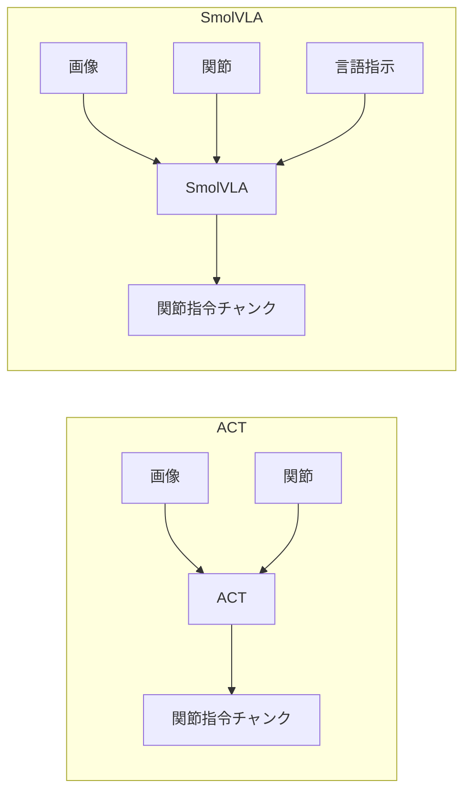

# 第1章レッスン2 — ACT と VLA（SmolVLA）は別物？

> 🎯 **ゴール**
> ①ACT と SmolVLA の入出力の違いを表で説明できる
> ②音声指示のときに何を足すか言える
> ③「完全に無関係」ではないが「用途が違う」と整理できる

---

## 2.1 入出力

| | ACT | SmolVLA（VLA の一例） |
|--|-----|----------------------|
| 画像 | ○ | ○ |
| 関節角 | ○ | ○ |
| **自然言語** | ✕（タスクはデモで固定） | **○** |
| 学習のしかた | ほぼデモから新規（ResNet は ImageNet 初期化） | **ベース重みを FT** |
| CLI の典型 | `--policy.type=act` | `--policy.path=lerobot/smolvla_base` |

どちらも広い意味では **模倣学習**（デモの `(観測, 行動)` を学ぶ）です。  
違うのは **観測に言語が入るか** と **巨大事前学習を持つか** です。



---

## 2.2 音声はどう繋ぐか

```text
マイク → 音声認識（STT）→ テキスト → SmolVLA の --task / 指示文
```

ACT にマイクを繋いでも、**ACT 側に言語入力が無い**ので指示にはなりません。  
（「声で ACT のオン／オフ」など外のスイッチにするなら別設計。）

---

## 2.3 学習順のおすすめ

1. **ACT** … カメラ・キャリブ・録画・学習・推論のパイプラインを通す  
2. **SmolVLA** … 同じデータ（＋タスク文）で言語条件を足す  
3. **他 VLA** … GPU・ライセンス・データ要件を見て選ぶ（第4章）

同じデモデータセットを、ACT と SmolVLA の両方で試すと比較学習になります。

論文・公式（ID は [papers.md](../papers.md)、提出は [references.md](../../reports/references.md)）:

| | 論文 | 公式 |
|--|------|------|
| ACT（R-PAPER-ACT） | [arXiv:2304.13705](https://arxiv.org/abs/2304.13705) | [LeRobot ACT](https://huggingface.co/docs/lerobot/act) |
| SmolVLA（R-PAPER-SMOLVLA） | [HF papers](https://huggingface.co/papers/2506.01844) | [LeRobot SmolVLA](https://huggingface.co/docs/lerobot/smolvla) |
| シムの PPO | [arXiv:1707.06347](https://arxiv.org/abs/1707.06347) | [RL の学習手順](03_rl_procedure.md) |

---

## ✅ 理解度チェック

<details>
<summary>Q1. 「赤いキューブを取って」と文で変えたい。ACT だけでも可能？</summary>

基本は不可（文を条件にしない）。赤いキューブのデモだけで学習した ACT は、その見た目分布の中で真似する。青を取りたいなら別デモ／別ポリシーか、VLA 側。
</details>

<details>
<summary>Q2. ACT と SmolVLA は完全に別分野か？</summary>

いいえ。どちらもデモ模倣の政策学習。入力のモダリティ（言語の有無）と事前学習の有無が違う。
</details>

⏭️ シムで RL を回す: [03_rl_procedure.md](03_rl_procedure.md) · 実機 ACT: [02_single_arm_act/](../02_single_arm_act/README.md)
