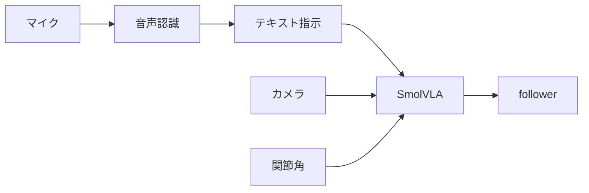

# 第3章レッスン2 — 自然言語と音声

> 🎯 **ゴール**
> 音声パイプラインのブロック図を描ける。ACT では足りない理由を再確認できる

---

## 3.2-1 言語

SmolVLA の条件付け:

```text
指示文 + 画像(+複数視点) + 関節角 → 行動チャンク
```

良い習慣:

- 録画時の文を **短く・具体的に・毎回同じ**にする  
- 「赤を取る」「青を取る」など **変えたい軸はデモにも含める**  
- 推論で別の文を投げるときは、その文に対応するデモがあるか確認する  

---

## 3.2-2 音声（設計だけ先に）



実装はラボ未固定でよい段階です。候補:

- クラウド STT / ローカル Whisper  
- テキスト確定後に `lerobot-rollout --task="..."` を起動、または常駐クライアントへ文を送る  

**ACT に音声を繋いでも指示にはならない**（第1章）。スイッチ用途なら別。

---

## 3.2-3 次に進む判断

| 状況 | 次 |
|------|-----|
| 文なしで作業再現できればよい | ACT で十分。SmolVLA は任意 |
| 文・声でタスクを切り替えたい | SmolVLA を主に育つ |
| 双腕・特定 VLA 重みが必要 | 第4・5章 |

---

## ✅ 理解度チェック

<details>
<summary>Q. 「音声で ACT」と宣伝されている製品がある。何が違う可能性？</summary>

外で STT→タスク選択（複数 ACT の切替）や、別の言語条件付きモデルを使っていることが多い。ACT 本体が音声を理解しているとは限らない。
</details>

⏭️ 次の章: [04_other_vla/](../04_other_vla/README.md)
