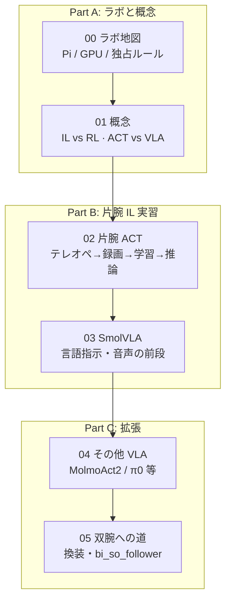

# so101-lab 学習カリキュラム — 実機で ACT → VLA →（将来）双腕

> 🎓 **このカリキュラムのゴール**
> 実機 SO-101（当面は **片腕 follower**）でデモを取り、**ACT** で模倣学習の一通りを通し、
> 次に **SmolVLA** で言語条件付き操作を試し、その先の **他 VLA・双腕** へ進める土台を作る。

sim2rl の [`../../../sim2rl/docs/learn/`](../../../sim2rl/docs/learn/README.md) が
**シミュレータ・強化学習・アーキテクチャ**の教科書なら、こちらは **ラボ実機・LeRobot IL・運用**の教科書です。  
両方を行き来しながら学ぶ想定です（下の「連携マップ」）。

各章は **読む → 動かす → 理解度チェック**。長いコマンドの正本は運用ドキュメントに置き、
ここは **順序・概念・なぜその順番か** を担当します。

> 📱 **スマホ・タブレットでも読めます**: リポジトリルートで `make docs-serve` を実行し、
> 同じ Wi-Fi の端末から `http://<PCのIP>:8100`（手順はリポ直下 README の「ドキュメントをブラウザ / スマホで読む」）。
> **外出先からは**: ①`make docs-print` の 1 枚 HTML をスマホ/Drive に置く（サーバー不要・圏外可）
> ②Tailscale 参加マシンで `./scripts/serve_docs.sh` を立ててスマホの Tailscale から閲覧、のどちらか。

---

## 推奨ルート（初学者）

```text
短腕/片腕の前提を理解
    → ACT（視覚+関節 → 操作のコピー）
    → SmolVLA（+ 自然言語）
    → 他 VLA（MolmoAct2 / π0 等）
    → 双腕（ハード換装後）
```

いまのラボ既定: 第2 **駆動**腕は OFF。デモ用 leader は **手テレオペ**のみ → [14_single_arm_il.md](../14_single_arm_il.md)

> 🧰 **部品箱・Pi 起動前からの「本当のゼロ」**は
> [00_lab_map/00_setup_from_zero.md](00_lab_map/00_setup_from_zero.md)（組立 → OS → 配線 → lerobot 導入 → 動作確認）。

---

## 🗺️ カリキュラムマップ



| 章 | 場所 | テーマ | 実習の正本 | 時間目安 |
|----|------|--------|------------|----------|
| 0 | [00_lab_map/](00_lab_map/README.md) | マシン分担・ツールの使い分け（[L0 ゼロから Lab を立てる](00_lab_map/00_setup_from_zero.md)） | [01_overview](../01_overview.md) · [07](../07_multi_host.md) | 30分（L0 は組立込み半日〜） |
| 1 | [01_concepts/](01_concepts/README.md) | IL / ACT / VLA、シム RL の手順 | [papers.md](papers.md) · sim2rl 02_rl | 45分 + RL 実習 |
| 2 | [02_single_arm_act/](02_single_arm_act/README.md) | 片腕 ACT 通し | [17](../17_act_record_train_infer.md) · [14](../14_single_arm_il.md) · checklist | 半日〜 |
| 3 | [03_smolvla/](03_smolvla/README.md) | SmolVLA FT・言語・音声 | [14](../14_single_arm_il.md) Step 4b/5 | 半日〜 |
| 4 | [04_other_vla/](04_other_vla/README.md) | 他モデルの地図＋比較実習・載せ方チェックリスト | [10](../10_molmoact2_thor.md) · [14 Step 4c](../14_single_arm_il.md) | 1時間（読物）＋実習 |
| 5 | [05_bimanual/](05_bimanual/README.md) | 双腕ロードマップ | [13](../13_drive_profiles.md) · [10](../10_molmoact2_thor.md) | 読物＋将来 |
| 6 | [06_force_obs/](06_force_obs/README.md) | 力覚観測IL（Present_Loadプロキシ / VFA実機入門） | [14](../14_single_arm_il.md) · [24](../24_model_eval_campaign.md) · sim2rl 07章 | 1時間＋録画 |

---

## 🔗 sim2rl `docs/learn` との連携

同じ SO-101 を、**シム側**と**実機側**から学びます。行き来の目安:

| 学びたいこと | 先に読む | 次に読む |
|--------------|----------|----------|
| 6関節・URDF・サーボ | **sim2rl** [01_so101](../../../sim2rl/docs/learn/01_so101/README.md) | 本カリキュラム 00 + ラボ [04_calibration](../04_calibration.md) |
| RL / PPO / 報酬 | 本 [01 レッスン3](01_concepts/03_rl_procedure.md)（回す手順） | **sim2rl** [02_rl](../../../sim2rl/docs/learn/02_rl/README.md)（仕組み） |
| GPU 物理シミュ（Kamino） | 本 [papers.md](papers.md)（元論文 R-PAPER-KAMINO） | ラボ [22](../22_kamino_sim.md)（SO-101 を GPU で動かす手順） |
| 論文リンク | 本 [papers.md](papers.md) | sim2rl [rl_methods.md](../../../sim2rl/docs/learn/rl_methods.md) |
| ニューラルネットの中身 | **sim2rl** [03_pytorch](../../../sim2rl/docs/learn/03_pytorch/README.md) | 本 02（ACT を「観測→行動」として見る） |
| Sim2Real・実機チェック | **sim2rl** [07_sim2real](../../../sim2rl/docs/learn/07_sim2real/README.md) | 本 02 の安全・独占 + [14](../14_single_arm_il.md) |
| ACT / Diffusion の手法位置 | **sim2rl** [rl_methods.md](../../../sim2rl/docs/learn/rl_methods.md) · [09 Bi-ACT](../../../sim2rl/docs/learn/09_advanced/05_paper_biact.md) | 本 01・02 |
| 双腕の設計レベル | **sim2rl** [09 dual_arm](../../../sim2rl/docs/learn/09_advanced/02_dual_arm.md) | 本 05 + ラボ [10](../10_molmoact2_thor.md) |
| 自分の機体・エンドエフェクタをURDFにする | **sim2rl** [12_urdf](../../../sim2rl/docs/learn/12_urdf/README.md)（URDFオーサリング。SO-101×AmazingHand合体URDFの実作込み） | ラボ [12 mujoco_sim](../12_mujoco_sim.md)（実機可動域・干渉チェック） |

> 💡 **先生の一言**: sim2rl で「観測・行動・学習ループ」の語彙を先に揃えると、
> LeRobot の `lerobot-record` / `lerobot-train` が突然の呪文に見えなくなります。
> 逆に、実機で ACT を一度通すと、sim2rl の模倣学習（EVA-ACT）の意味が腹落ちします。

相対パス（両リポが `~/robot/` 配下にある前提）:

```text
so101-lab/docs/learn/   ← いまここ（実機 IL）
sim2rl/docs/learn/      ← シム RL・設計・Sim2Real
```

---

## 運用ドキュメントとの役割分担

| 種類 | 役割 | 例 |
|------|------|-----|
| **learn/**（本フォルダ） | 学習順・概念・理解度チェック | この README |
| **docs/0x〜1x** | 運用正本（コマンド・ポート・トラブル） | [14](../14_single_arm_il.md) |
| **checklists/** | 個人の進捗チェック | [single_arm_il](../checklists/single_arm_il.checklist.md) |
| **docs/reports/** | 提出・工夫/失敗・参考文献 | [design_notes](../reports/design_notes.md) |

手順の数字（by-id・カメラパス）が変わったら **運用 docs を直し**、learn からはリンクだけ追う。

---

## 学習のガイドライン

1. **読む → 動かす → 説明する**（理解度チェックは折りたたみを先に開けない）
2. **長時間 GPU・実機トルク ON は確認してから**（[reports/AGENT.md](../reports/AGENT.md)）
3. **Web Remote と LeLab は同時起動しない**
4. **詰まったら** [06_troubleshooting](../06_troubleshooting.md) → それでもだめなら design_notes に F- 候補をメモ

⏭️ まずは [00_lab_map/](00_lab_map/README.md) から。
